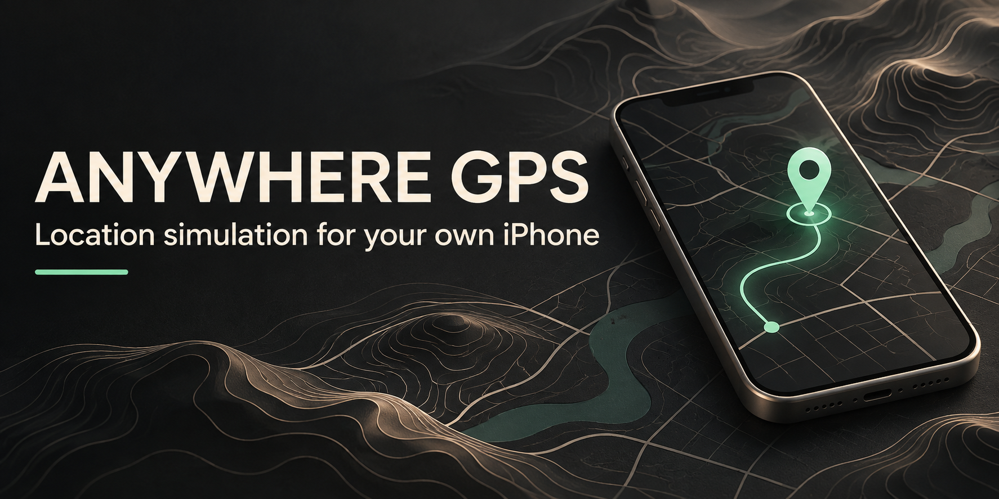

<p align="center">
  
</p>

<p align="center">
  <a href="LICENSE"></a>
  
  
  <a href="docs/TEST_RESULTS.md"></a>
</p>

<h1 align="center">Anywhere GPS</h1>
<p align="center">Harmless map pranks with friends, using your own iPhone.</p>
<p align="center">
  <a href="docs/ON_DEVICE.md">Get started on iPhone</a> ·
  <a href="#quick-start-on-mac">Mac app</a> ·
  <a href="docs/TEST_RESULTS.md">Hardware evidence</a> ·
  <a href="docs/PRIVACY.md">Privacy</a> ·
  <a href="ARCHITECTURE.md">Architecture</a>
</p>

Anywhere GPS lets you put your own iPhone somewhere unexpected for a harmless
map prank with friends. Pick a place, show the simulated location in Apple Maps,
and restore real GPS when the joke is over.

**Just your iPhone for everyday use, after initial setup on a Mac.** The on-device
build runs on your phone with LocalDevVPN; the tested flow needs no attached Mac
or USB cable. Initial installation and free-signing renewal use Xcode on a Mac.

**Up to seven days per free signing profile.** Renew through Xcode before the
app's actual expiry, keeping the same bundle ID. Seven days is the signing
window; continuous week-long operation has not been tested.

This experimental project includes reproducible patches for the on-device
StikDebug build, plus an optional local Mac app with a React/Leaflet map and
FastAPI backend over Apple's developer location service.

No jailbreak or paid signing is required for the tested flow. Map, search,
developer-image and signing features can make external requests; see the
[privacy boundaries](docs/PRIVACY.md).

## Two ways to use it

| | Mac app | On-device build |
| --- | --- | --- |
| Controls | Browser map, coordinates, search and favorites | StikDebug map, search, bookmarks and restore |
| Connection | Mac stays awake and connected to iPhone | LocalDevVPN on phone; tested without USB |
| Technology | FastAPI, React, Leaflet, pymobiledevice3 | Pinned StikDebug source plus local patches |
| Setup | Python, Node, trusted USB, Developer Mode | Xcode Personal Team, protected pairing, VPN |
| Evidence | Set/restore observed in Apple Maps | One **10m28s unplugged locked test passed**, followed by verified restore |

StikDebug is an independent upstream project. This repository distributes a
[pinned patch set](ondevice/README.md), not a pre-signed app or a bundled native binary.

## What is included

- **Pick a location:** click the map, enter coordinates, search, or use favorites.
- **See session state:** readiness checks, actionable errors, bounded retries and loss reporting.
- **Restore explicitly:** command acceptance is separate from verifying real GPS.
- **Recover deliberately:** no silent reapplication after a lost connection.
- **Develop without a phone:** visibly marked mock mode uses fake devices.
- **Inspect the evidence:** structured Maps observations and a repeatable test protocol.

## Quick start on Mac

You need macOS, Python **3.12 or 3.13** (the installer looks for either), Node
**18+** for the frontend build, and your own iPhone on **iOS 17.4+**. Hardware
observations were made on **iPhone18,2 / iOS 26.4**.

```bash
git clone git@github.com:shrey1110-dotcom/Anywhere-GPS.git
cd Anywhere-GPS
./scripts/install.sh
./scripts/run.sh
```

Open **http://127.0.0.1:8765**. The API binds to localhost and rejects nonlocal
Host/Origin requests.

1. Connect the iPhone by USB, unlock it, and approve Trust in Apple's UI.
2. Enable **Settings → Privacy & Security → Developer Mode** and complete its restart.
3. Follow the app's readiness guidance. Mount a developer image if needed.
4. Choose a location and press **Set Location**. Keep the Mac awake and connected.
5. Confirm the current-location blue dot in Apple Maps.
6. Press **Restore Real GPS**, then independently confirm your real location.

Explore without touching a real device:

```bash
./scripts/run.sh --mock
```

For a terminal session, stop the web server first:

```bash
.venv/bin/python scripts/set_location.py 37.3349 -122.0090
# Ctrl+C requests restore; confirm real GPS in Maps.
```

The developer connection must remain open for the Mac route. Raspberry Pi/Linux
is a possible wired-host fallback, but deployment has **not** been verified here.

## Use the phone without the Mac attached

Follow the [on-device guide](docs/ON_DEVICE.md) and
[source-build instructions](ondevice/README.md). The tested build uses a free
Personal Team and a stable bundle ID.

Connect LocalDevVPN, select a location in StikDebug, and confirm
**Location updates active** and **Background location session ready**. Leave
StikDebug in the background, keep VPN connected, and use Restore Real GPS when finished.

Free signing needs renewal through Xcode on the Mac before the app's actual
seven-day profile expiry. Keep the same bundle ID and preserve local pairing.
Free Personal Team signing supports up to three active development apps.

## What the hardware test proves

| Final candidate check | Observed result |
| --- | --- |
| Both location-session readiness messages | Passed |
| Apple Park current-location blue dot in Maps | Passed |
| USB physically disconnected; iPhone locked for **10m28s** | Passed |
| Maps inspected before reopening StikDebug | Still at Apple Park |
| Restore Real GPS with USB unplugged | Reported successful |
| Separate Maps check after restore | Real location confirmed |

An earlier candidate **failed** its 10m20s locked test. That result remains in
the report. One passing interval does not establish overnight reliability,
survival after termination/reboot, VPN recovery, or behavior after profile expiry.

These are Maps UI observations, not a Location Probe source-information reading.
No compatibility claim is made for other apps. See the
[full evidence](docs/TEST_RESULTS.md), [structured observations](compat/results.json)
and [test protocol](docs/TEST_PROTOCOL.md).

## Development and verification

```bash
.venv/bin/python -m pytest -q
cd frontend
npm ci
npm run build
```

The original backend baseline has **40 passing mock-device tests**. Session
safety and expiry parsing were exercised separately for the phone build.
Publication checks are recorded in [VALIDATION.md](docs/VALIDATION.md).

```text
backend/anywhere_gps/  Device services, session state, API and mock backend
frontend/             React + Leaflet browser controls
scripts/              Install, launch, terminal control and local pairing export
LocationProbe/        Optional SwiftUI Core Location diagnostic source
ondevice/             Pinned StikDebug patches, manifest and provenance
compat/               Structured physical-device observations
tests/                Mock-device regression suite
docs/                 Guides, privacy, test evidence and publication history
```

The [publication history](docs/HISTORY.md) is a current-dated import of existing
local work, organized for review rather than backdated to imitate development.
Private handoffs and device credentials are excluded.

## Privacy and intended use

Keep Apple Account credentials in Apple's interfaces. Pairing credentials stay
only on your Mac and phone with mode **600**; never commit or upload them.
The bundled upstream native library and LocalDevVPN are **not fully audited**.

This tool does not hide software simulation from other apps. Attendance/clock-in
falsification, geofence fraud and integrity-check bypass are outside this project.
Read [PRIVACY.md](docs/PRIVACY.md) and [SECURITY.md](SECURITY.md) before sharing logs.

## License and credits

**GPL-3.0-or-later**; see [LICENSE](LICENSE) and
[THIRD_PARTY_LICENSES.md](THIRD_PARTY_LICENSES.md).
The Mac route uses pymobiledevice3, FastAPI, React and Leaflet; map data is from
OpenStreetMap contributors. The phone route builds on
[StikDebug](https://github.com/StikDebug/StikDebug); its license and contribution
rules are retained under `ondevice/`. See [PROVENANCE.md](ondevice/PROVENANCE.md).

The hero is an AI-generated conceptual illustration, not an application screenshot.
